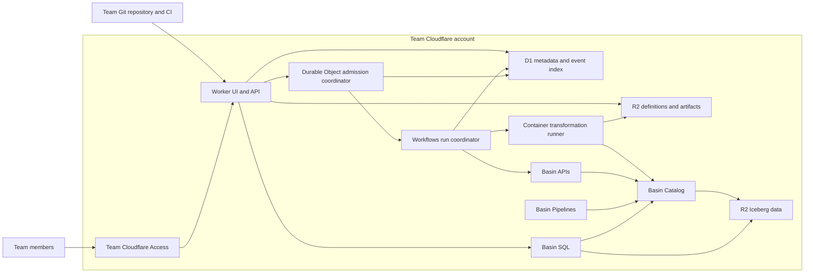
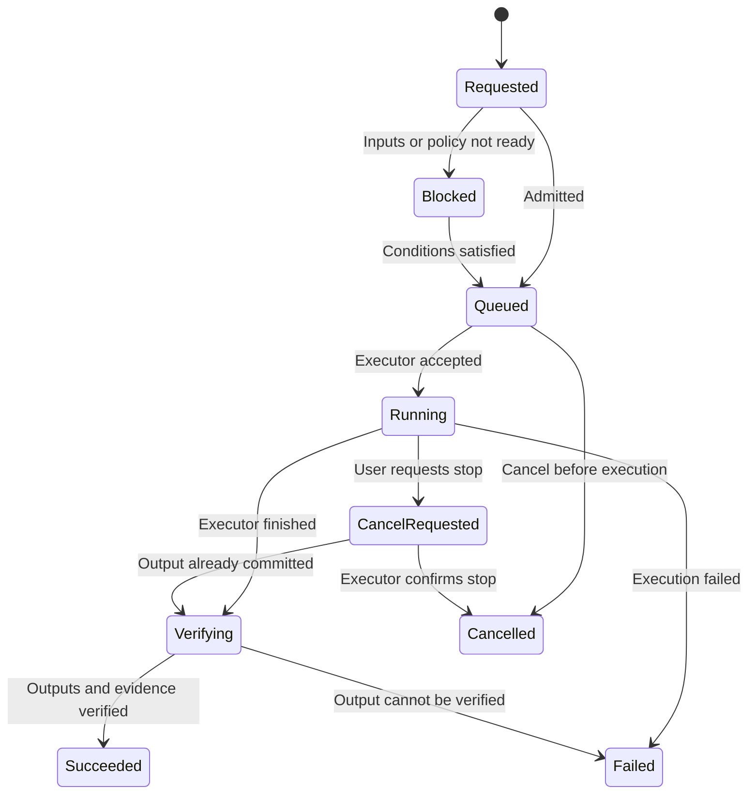

# Architecture and execution model

Status: proposed, pending the [technical gates](validation-plan.md). Vendor capabilities and limits are documented in the [Basin assessment](../research/cloudflare-basin.md). The current repository contains no implementation of this architecture.

## Deployment boundary

One installation belongs to one team's Cloudflare account. The browser UI, API, authentication configuration, metadata, scheduling, orchestration, secrets, artifacts, and Basin resources operate there. Each installation must remain usable without a central Dagflare API, account directory, license-check endpoint, credential broker, telemetry collector, or hosted scheduler.

The release repository and optional package registry distribute software. The team's Git provider stores code and reviews. Its existing identity provider supplies identities through Cloudflare Access. These are explicit external integrations, not a shared Dagflare control plane. Optional notifications or external execution adapters must be configured by the team and can be disabled.

The Container adapter is a candidate, not a validated remote integration. CI can submit a signed definition artifact without leaving its own runner as a required persistent service.

## Component responsibilities

**Worker UI/API:** serve static application assets and APIs; validate identity and authorization; compile/accept reviewed definition artifacts; query catalog/metrics through adapters; expose asset/run/change views; receive signed Git events; offer bounded data previews. Keep all privileged service credentials server-side.

**D1:** index definitions, resources, runs, materializations, observations, check results, roles, operational overrides, and audit events. Maintain queryable projections for UI use. Avoid storing large logs, query results, or dbt manifests in rows. Archive aged events/artifacts to R2 with retention and deletion rules. Design around D1's database-size ceiling; do not promise unbounded event retention.

**R2 application bucket:** store immutable definition bundles, manifests, run results, logs, query exports, and archives keyed by content digest and run/definition identifiers. Separate this bucket from analytical data where authorization or retention differs. Secret values do not belong in artifacts.

**Workflows:** coordinate durable run steps, invoke adapters, wait for execution evidence, retry recoverable actions, and record terminal results. Its own status/logs are operational aids, not the permanent audit store. Every external side effect needs its own idempotency contract.

**Durable Object coordinator:** serialize admission and shared-resource changes where necessary; own durable leases, schedule cursors, and capacity reservations. D1 supplies indexed history and unique constraints, while the coordinator supplies serialized resource decisions. Neither process memory nor an in-process mutex is a durable lock.

**Queues, if needed:** buffer incoming events and decouple projections or runner commands. Introduce them when measured traffic warrants it; do not create another source of truth. Messages need identities, deduplication, bounded retries, and a dead-letter path.

**Basin adapter layer:** inventory streams/pipelines/sinks/catalog tables, query metadata, fetch usage/error metrics, and perform explicitly authorized resource actions. Capture supported capabilities per API/version so legacy naming remains isolated from the domain model.

**Execution adapters:** submit work, query status, cancel when supported, and return per-output evidence. First candidates are lightweight Worker calls and a dbt/DuckDB Container in the same account. External Spark/Trino or team runners are optional fallback integrations, never a hidden mandatory central service.

## Domain model

| Entity                     | Identity and important attributes                                                            |
| -------------------------- | -------------------------------------------------------------------------------------------- |
| Installation               | Account, configured projects, deployed application version                                   |
| Environment                | Production/staging/preview identity; physical resource and credential scope                  |
| DefinitionVersion          | Git provider/repository/SHA, base SHA, manifest digest, compiler version, immutable artifact |
| AssetDefinition            | Stable asset key, kind, owner, dependencies, source/config/check/policy digests              |
| ResourceBinding            | Environment, physical catalog/table/stream/sink IDs, observed versus managed authority       |
| RunRequest                 | Trigger, selected assets/partitions, definition digest, idempotency key, requester, reason   |
| Run and Attempt            | Logical run identity, attempt identity, executor, state, timings, artifact references        |
| Materialization            | Asset/partition, definition version, committed output snapshot, input versions, run attempt  |
| Observation                | Source, observed schema/snapshot/watermark, timestamp, confidence, collection errors         |
| CheckResult                | Check definition, output/input evidence, result, severity, execution timestamp               |
| Schedule/Policy Evaluation | Definition policy, expected tick, cursor, reason, resulting request or skip                  |
| OperationalOverride        | Pause/admission/cost controls with actor, scope, timestamp, expiry                           |
| AuditEvent                 | Actor/service identity, action, affected object, authorization context, request identity     |

“Code version,” “data version,” and “deployment version” must remain separate. A definition can execute repeatedly over different source snapshots; a maintenance snapshot can leave semantic data unchanged; a software upgrade can leave definitions unchanged.

An initial stable asset key can be a namespaced logical path. The environment maps it to physical resources. Renaming a physical table should not automatically destroy the logical asset's history. Renaming a logical key requires an explicit identity migration.

## Definition compilation and deployment

1. Read the repository at an exact Git SHA; validate manifest/schema and referenced SQL/dbt files.
2. Reject cycles, unresolved dependencies, unsupported dialects/adapters, malformed partition mappings, and secret values embedded in configuration.
3. Compile a deterministic graph and capability/resource plan. Preserve the compiler/schema version in the digest.
4. Compare against a named deployed or repository-base definition. Show added/changed/removed assets and destructive resource proposals.
5. Store the immutable bundle in team-owned R2 and publish its metadata to D1.
6. Promote an authorized bundle by changing the active definition pointer and recording a deployment event.

Promotion does not itself delete resources, change retained data, enable schedules, or restart every in-flight run. Resource provisioning/migration is a separately authorized plan. Runtime controls persist independently so a code rollback cannot unexpectedly resume paused work.

A run pins its definition artifact, inputs where possible, runner image digest, adapter versions, and policy evaluation. Updating production changes future requests; old requests remain tied to their original definition. If a runner cannot execute that version anymore, surface an explicit incompatible-version failure.

## Finite run lifecycle and correctness

Check outcomes are recorded alongside the committed output. A run can succeed at computation while the asset is degraded by failed checks. Downstream admission evaluates an explicit check policy; the UI should not conflate “data committed” and “data approved.”

Before launching an adapter, persist a unique logical request and an outbox action in D1. The coordinator admits the request under its resource limits. A dispatcher submits the outbox action using a deterministic executor idempotency key, then records the external identity. This handles crashes between storing the request, creating a Workflow, and acknowledging it. Reconciliation retries undelivered actions and queries accepted work before resubmission.

Retries retain the logical run but create explicit attempts. A dbt process that committed a table and lost its response must be reconciled against output evidence rather than launched blindly. Iceberg commit conflicts can be retried according to the writer's contract; partial multi-table commits require per-model results, not a false all-or-nothing claim.

Use durable leases and fencing tokens for conflicting writers. A lease timeout alone must not authorize a second writer while the original process can still commit. The runner or commit adapter must reject stale fencing tokens, or Dagflare must conservatively require confirmed executor termination before admitting a replacement. Prove this before enabling automatic retry of non-idempotent workloads.

Large data, log streams, and manifests live in R2; Workflow steps return identifiers and compact evidence. HTTP errors, rate limits, auth failures, schema errors, data-quality failures, and unknown execution status get distinct error classes and retry policies.

## Continuous ingestion and observations

Basin Pipelines operate continuously. Dagflare records their configuration version, producer stream binding, sink targets, health/error metrics, and observed output snapshots. It does not create a synthetic successful batch run for every metrics poll.

For ingested assets, freshness can combine sink activity, observed table snapshots, and a dataset-specific event-time watermark. A snapshot's commit timestamp may reflect compaction rather than new events. Polling collection age and collection errors must be visible. Correlation from a pipeline to a table does not prove row-level provenance.

Definition lineage records intended dependencies. Observed lineage records adapter/dbt/runtime evidence. Each edge carries source and version. If parsing cannot determine a column dependency, mark it unknown or asset-level; do not invent a precise column graph.

## Scheduling and backfills

Start with a single account-owned UTC scheduling entry point plus D1 policies and a durable schedule cursor. Current Cloudflare also supports Workflow binding schedules; these are suitable for fixed installation jobs. Avoid redeploying a Worker or spending one platform cron quota for every UI-edited asset schedule.

Persist an expected tick identity and unique request key. Define what happens after downtime: skip missed ticks, coalesce to the latest tick, or catch up within a bound. The initial default should be explicit coalescing for recurring refreshes; historical partition backfills are separate requests. Schedule pausing prevents new admission and does not silently cancel existing runs.

Daily partitions are a reasonable first supported partition type. The planner computes the requested partition DAG and input mappings, estimates quota/cost, and admits bounded chunks. Backfill cancellation stops new admission and communicates which partitions already committed. Streaming-ingest replay is a different operation and requires a confirmed retention/replay contract.

Dependency policies need concrete readiness predicates: input committed, applicable checks passed, required partitions available, no conflicting attempt, and execution quota available. Explanations are saved with each evaluation. Avoid polling that launches a run on every snapshot change regardless of whether the data actually changed.

## dbt runner contract

The proposed Container runner receives a definition bundle reference, exact image/code digest, selection, environment/target binding, attempt ID, and scoped secret references. It obtains only the credentials needed by that target, builds/runs the project, emits structured events, and uploads current-run artifacts.

Dagflare imports the dbt manifest graph and links model unique IDs to stable asset keys. It interprets run results as success/failure/error/skipped with adapter details. Verification establishes the actual output table and committed snapshot; the process's exit code remains part of the evidence.

Keep untrusted PR execution isolated from production writer credentials and private artifacts. Initial previews compile against fixtures and produce plans. Runtime-selected container images, snapshots, incremental strategies, and global concurrent writes are later capabilities contingent on tests.

## Storage, recovery, and evolution

Use append-only event records with idempotent projection updates where practical. A replay tool must rebuild UI projections from retained evidence; do not assume every old projection can be reconstructed after its source artifacts are expired.

Back up D1 state and application R2 objects under a documented retention policy. Record schema migrations and test upgrade/rollback compatibility. Iceberg data snapshots have separate retention; an application backup does not restore analytical data. Installation deletion must distinguish application metadata from user-owned catalogs/data.

Run history and audit data may contain sensitive metadata or query text. Apply retention and role checks to artifacts as well as rows. Disable central telemetry by default; software version checks must be optional and must not transmit customer metadata.

## Architecture decisions and alternatives

| Decision                              | Rationale                                                                  | Revisit when                                                           |
| ------------------------------------- | -------------------------------------------------------------------------- | ---------------------------------------------------------------------- |
| Complete application per team account | Explicit owner requirement; independent credentials/state/failure boundary | A hosted offering is separately requested                              |
| Asset graph as the domain model       | Connects catalog, lineage, dbt, freshness, and review                      | Imperative-only workflows dominate validated needs                     |
| Workflows for finite coordination     | Durable Cloudflare execution without operating a daemon                    | Unsupported required semantics or reliability limits appear            |
| D1 index plus R2 artifacts            | Queryable app state without storing analytical data in SQLite              | Measured metadata scale or write contention demands partitioning       |
| Container candidate for dbt           | Conventional Python runtime and documented DuckDB Iceberg path             | Live materializations or resource limits fail technical gates          |
| Plan-only previews first              | Strong isolation and constrained Basin resource quotas                     | A safe, bounded live sandbox is proven                                 |
| Separate operational overrides        | Prevents unexpected resume/admission during definition rollback            | Never combine silently; only change with a reviewed semantic migration |

The largest design risk is building too much orchestration before proving the writer, admission, and deployment contracts. Implement a narrow end-to-end slice first, then expand policies and adapters.
